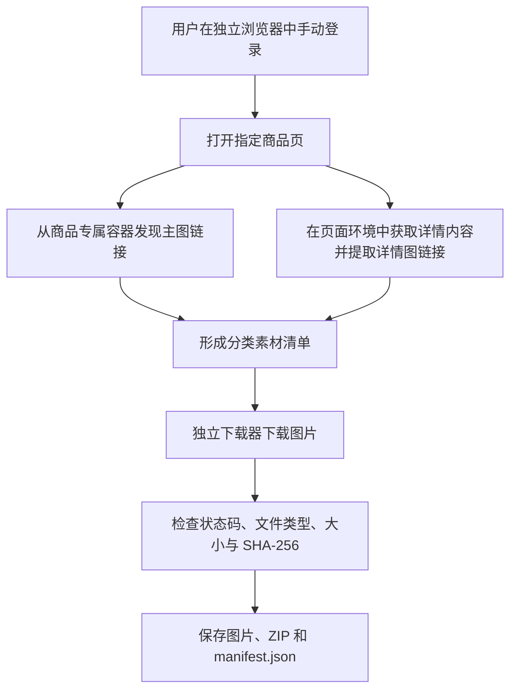

# 京东商品主图与详情图下载流程示例

从一个本地竞品监控项目中独立整理的技术分享版，重点说明：**怎样发现商品素材链接，以及怎样下载、校验和归档主图与详情图**。

这是独立仓库，使用全新 Git 历史，不依赖原项目服务、数据库或配置。默认只采集一个 SKU，不含调度、价格采集、OCR、通知和完整工作台。

## 流程



## 包含什么

| 内容 | 说明 |
|---|---|
| 主图发现 | 商品轮播容器 → 兼容旧版缩略图容器 → 页面商品配置 |
| 详情图发现 | 使用当前页面已有的签名功能获取商品详情内容，提取受控图片域名链接 |
| 下载器 | Python 标准库；分类保存、内容校验、SHA-256、ZIP 归档 |
| 独立入口 | 离线演示、手动登录、单商品采集 |
| 文档与测试 | 流程、错误边界、离线回归、来源与验证限制 |

本分享版默认仅输出主图和详情图。底层复制的下载器保留原有视频类型兼容能力，但不把视频作为本分享版的采集承诺。主图沿用来源项目的 **800×800 URL 规范化策略**，不承诺获取最高分辨率原图。详情图保留发现时的来源路径。

## 先运行离线演示（不需要京东账号或浏览器）

需要 Python 3.11 或更新版本。在本仓库根目录打开 PowerShell：

```powershell
$env:PYTHONPATH = "$PWD/src"
python -m jd_images demo
python -m unittest discover -s tests -v
```

演示会生成两张原创 8×8 色块 PNG，使用内存响应模拟下载传输，真实执行文件校验、哈希和 ZIP 归档。**不会访问京东，不代表真实商品页面验收。** 图片、ZIP 和清单保存到 `.local/downloads/sessions/<随机编号>/`，不进入 Git。

## 真实采集准备

1. 建议把本仓库、Python 虚拟环境和浏览器运行时放在 D 盘。
2. 自行创建独立虚拟环境；仅在需要真实浏览器采集时安装 `requirements-browser.txt`。
3. 通过 Camoufox 官方安装说明准备兼容的浏览器运行时。Python 包版本见依赖文件；浏览器二进制需单独准备，不随本仓库提供。浏览器安装命令与缓存目录随版本变化，请核对所用版本的官方说明。本程序不会自动安装或下载浏览器。
4. `--runtime-root` 指向现有 Camoufox 缓存根目录；该目录应为 Camoufox 当前版本可识别的缓存结构，不能随便指向 Chrome 安装目录。
5. 本程序在当前仓库的 `.local/browser-profile/` 创建独立登录环境，必须由使用者亲自登录。不要复制他人的 profile、Cookie 或原项目登录态；不要同时打开占用这个 profile 的另一进程。

依赖安装示例（这一步会联网下载软件，请在自己的设备上决定是否执行）：

```powershell
python -m venv .venv
.\.venv\Scripts\python.exe -m pip install -r requirements-browser.txt
```

在仓库根目录使用同一 Python 解释器执行：

```powershell
$env:PYTHONPATH = "$PWD/src"
# D:\BrowserRuntimes\camoufox 是示意路径，需替换为自己实际安装的位置。
.\.venv\Scripts\python.exe -m jd_images login --runtime-root 'D:\BrowserRuntimes\camoufox'

# 123456789012 是虚构示例，需换成你有权访问的真实商品 SKU。
.\.venv\Scripts\python.exe -m jd_images collect --runtime-root 'D:\BrowserRuntimes\camoufox' --sku 123456789012
```

出现登录保护、验证码、访问限制或 HTTP 401/403/429 时停止。完成必要的人工处理后，由使用者决定是否重新执行，不自动重试或绕过。

## 输出怎么读

| 文件 | 用途 |
|---|---|
| `files/` | 本次下载的图片 |
| `raw-materials.zip` | 按“主图 / 详情图”分类的归档 |
| `manifest.json` | 成功完成标记，包含分类、相对文件路径、字节数、Content-Type 和文件/ZIP 哈希 |

清单中的 `temporaryPath` 与 `rawZipTemporaryPath` 均相对 `.local/downloads/`，`sourcePath` 为 ZIP 内路径。清单不包含素材原始链接、Cookie 或签名参数。

失败时可能保留本次部分文件用于本地调查，**没有 `manifest.json` 就不能当作已完成的采集**。退出码 0 表示命令完成，退出码 1 表示失败或中止。成功下载只证明发现的文件完成下载，不证明页面所有图片都被发现。

## 目录

```text
src/jd_images/discovery.py    从原采集器提取的素材发现逻辑
src/jd_images/downloader.py   从原项目复制的独立下载器
src/jd_images/cli.py          分享版独立入口与离线演示
docs/FLOW.md                 页面发现与下载细节
docs/ERRORS.md               错误处理、隐私与已知限制
docs/PROVENANCE.md           来源、拆分边界与验证记录
examples/task.example.json   底层下载器输入结构（虚构，不能直接下载）
tests/                       不访问真实平台的回归测试
```

## 验证与使用边界

独立版本完成了离线演示及自动测试，详情见 [来源与验证记录](docs/PROVENANCE.md)。本次整理未登录京东、未发起真实商品采集，因此不承诺新入口在所有设备与页面模板上均可运行。

本仓库不包含账号、运行数据、真实商品图片或第三方浏览器二进制。底层下载器只发送必要的 Accept/Referer 等请求头，不复制浏览器 Cookie；详情发现仅在用户自己的正常页面环境中使用页面已有能力，相关临时参数不导出、不记录。适配逻辑可能随平台页面或接口变化而失效。

仅在有权访问和使用素材的范围内使用，遵守平台规则与素材权利。当前保留作者权利，**尚未采用开放源代码许可证**，见 [LICENSE](LICENSE)。第三方依赖及其内容适用各自许可，代码分享不授予商品图片使用权。
